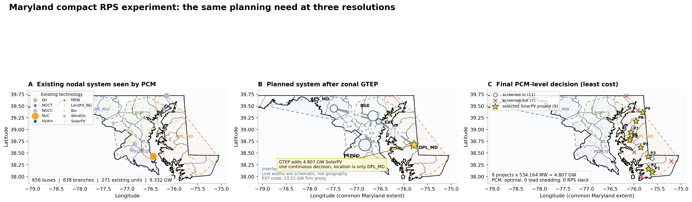
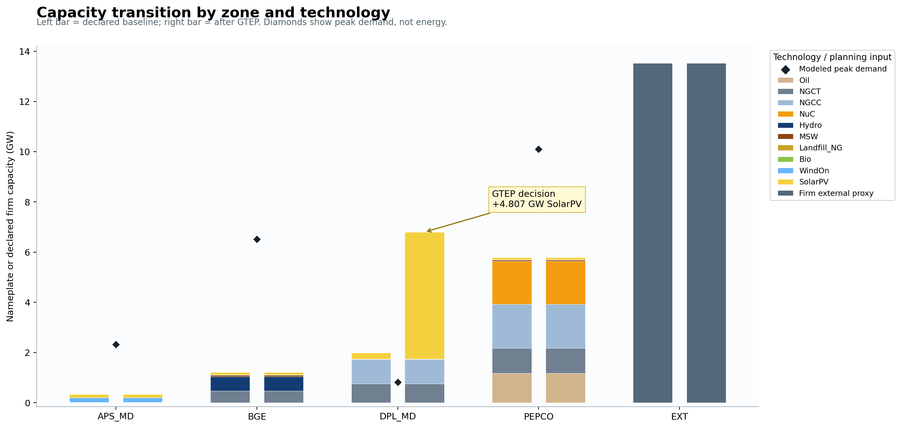

# [Maryland Compact RPS Experiment: Concrete System Walkthrough](@id md-compact-rps-experiment-summary)

!!! warning "Workflow demonstration, not a Maryland build forecast"
    Existing generators and network identities come from the HOPE Maryland
    public cases. The external firm supply, project sizes, candidate-site
    development evidence, permits, queue status, land, and community-review
    fields are declared or synthetic experiment assumptions. The selected
    buses therefore demonstrate the method; they are not recommended projects.

## One-paragraph result

The experiment starts with a Maryland PCM system containing 656 buses, 838
branches, and 271 existing generator units with 9.332 GW of nameplate capacity.
For planning, those physical details are aggregated into four Maryland zones
plus one external zone. Under a 20% Maryland-to-Maryland RPS, a 15% planning
reserve margin, and 13.526 GW of declared firm external supply, GTEP builds
4,807.474 MW of SolarPV in `DPL_MD`. A deterministic rule converts this
continuous decision into nine equal 534.164 MW projects. The realization layer
screens 18 nodal candidates, retains 11, and selects nine buses. The accepted
`least_cost` portfolio then passes the 168-hour nodal PCM with an optimal
solution, zero load shedding, and zero RPS slack.

This is the most important interpretation:

> GTEP did **not** select nine projects or nine buses. It selected one zonal
> capacity quantity. Unitization and realization supplied the missing physical
> detail, and PCM tested whether that detail could operate.

## The modeled system at three resolutions



Read the panels from left to right:

1. **Existing PCM system.** Lines are the 838 modeled nodal branches. Colored
   circles are existing generator locations; marker area increases with MW and
   color follows HOPE's standard technology palette.
2. **GTEP system.** The same grid is compressed to five planning zones.
   Interface labels are modeled GW limits. The yellow star is a *zonal* SolarPV
   build, not a project site.
3. **Realized PCM system.** The DPL Maryland network is restored. Open circles
   passed the hard screen, red crosses failed it, and yellow stars are the nine
   sites selected by the accepted `least_cost` policy.

All three panels use the same longitude/latitude bounds and aspect ratio. The
black lines are Maryland's 2025 generalized state exterior and county
boundaries from the [U.S. Census Bureau TIGER/Line geography](https://www.census.gov/geographies/mapping-files/2025/geo/tiger-line-file.html).
They are a geographic reference layer, not a model input. The
colored dashed outlines are convex envelopes of the buses assigned to each
HOPE planning zone, so they make the model's spatial partition visible. They
are **not** utility-service-territory, county, legal, or permitting boundaries.
The map is a network visualization using coordinates from the case; it is not
an electrical one-line diagram, power-flow result, or interconnection
deliverability map.

## What existed before GTEP

The Maryland PCM case has the following modeled peak demand and existing
nameplate capacity. The external supply is intentionally excluded from the
"existing generation" column because it is a planning proxy, not a physical
Maryland generator fleet.

| Planning zone | Modeled peak demand (GW) | Existing generation (GW) | Main existing technologies |
| --- | ---: | ---: | --- |
| `APS_MD` | 2.327 | 0.338 | SolarPV, WindOn, Hydro |
| `BGE` | 6.520 | 1.210 | Hydro, NGCT, SolarPV, waste/biogas |
| `DPL_MD` | 0.819 | 1.992 | NGCC, NGCT, SolarPV, landfill gas |
| `PEPCO` | 10.098 | 5.791 | Nuclear, NGCC, NGCT, Oil, SolarPV, waste/biogas |
| **Maryland total** | **19.763** | **9.332** | 271 modeled units |

Existing capacity by technology is 2.726 GW NGCC, 2.225 GW NGCT, 1.708 GW
nuclear, 1.182 GW oil, 0.590 GW hydro, 0.575 GW SolarPV, 0.190 GW onshore wind,
and 0.137 GW of MSW, landfill gas, and bioenergy combined.

The gap between 19.763 GW of modeled peak demand and 9.332 GW of Maryland
nameplate generation is why the treatment of external supply is decisive. The
experiment declares four non-RPS firm external proxies totaling 13.526 GW.
Their zero marginal *decision* cost means "sunk baseline supply" in this test;
it does not mean that imported energy is free or guaranteed in reality.

## What changed after GTEP



The capacity plot separates nameplate or declared firm capacity from peak
demand. It should not be read as an energy balance. In particular:

- nameplate solar MW cannot be compared one-for-one with peak demand MW;
- the external bar is a declared planning contribution, not a physical plant;
- GTEP annualizes representative chronology when enforcing the RPS; and
- only `DPL_MD` changes because the optimal GTEP decision is 4.807 GW of
  SolarPV in that zone.

GTEP could choose NGCC, SolarPV, or WindOn in each Maryland zone, up to their
declared candidate limits, as well as candidate batteries and four candidate
transmission upgrades. It selected only DPL SolarPV. The 4.807 GW result is
close to the 5 GW DPL solar candidate limit and is sensitive to the declared
solar profile, external supply, costs, RPS accounting, and chronology.

### Why is all new capacity solar?

Solar was the optimal result, not the only technology available:

| Candidate option | Available in each MD zone | RPS eligible | Annual investment assumption | Capacity-credit assumption | Final build |
| --- | ---: | ---: | ---: | ---: | ---: |
| NGCC | 5,000 MW | No | USD 110,000/MW-year | 0.90 | 0 MW |
| SolarPV | 5,000 MW | Yes | USD 70,000/MW-year | 0.25 | 4,807.474 MW in `DPL_MD` |
| WindOn | 4,000 MW | Yes | USD 95,000/MW-year | 0.15 | 0 MW |
| Battery | 2,000 MW / 8,000 MWh | Does not create RPS energy | USD 125,000/MW-year | 1.00 in this case | 0 MW |

NGCC could provide firm capacity but could not satisfy the local RPS. Batteries
could shift eligible energy but could not create it. Both solar and wind were
RPS-eligible, but the declared solar option had lower annual investment cost,
higher capacity credit, and a favorable DPL hourly profile/network position.
With the firm external proxy already covering much of the adequacy need, the
model had no reason under these assumptions to build additional NGCC, storage,
or transmission. This is a case-design outcome; changing renewable costs,
profiles, capacity credits, external firmness, or reliability constraints can
produce a mixed portfolio.

## Assumption ledger

| Topic | Assumption used in this experiment | Why it matters |
| --- | --- | --- |
| Policy | 20% local RPS for `MD -> MD`; external resources receive no RPS credit | Creates the renewable build need |
| Adequacy | 15% system planning reserve margin | Requires firm capacity above modeled peak demand |
| Existing fleet | 271 units, 9.332 GW, retained from the public Maryland paired cases | Defines the starting generation mix |
| External supply | Four firm non-RPS proxies totaling 13,525.82 MW | Prevents the Maryland-only model from replacing the rest of PJM with new local generation |
| External proxy cost | Zero marginal decision cost | Treats the proxy as sunk baseline supply; not a market-price forecast |
| Planning network | Four Maryland zones plus `EXT`; zonal interface limits | GTEP can choose a zone but cannot choose a bus |
| Operational network | 656 buses and 838 branches | PCM evaluates nodal commitment, dispatch, and transmission constraints |
| Chronology | 168 hours; GTEP uses representative-period weights totaling 365 days; PCM checks one July week | Planning is annualized, while the operational validation is only one stress sample |
| Candidate technologies | NGCC, SolarPV, and WindOn in each Maryland zone; batteries and selected line upgrades are also available | Defines what GTEP is allowed to build |
| Solar availability | Zone-specific hourly profile; static availability is forbidden for candidate VRE | Determines the solar MW required to produce annual RPS energy |
| Project unitization | Solar target 550 MW, allowed range 400--650 MW, equal blocks, exact MW conservation | Converts continuous MW into auditable discrete projects without re-optimizing total MW |
| Candidate geography | Actual PCM bus and branch identities | Keeps the handoff on the operational network |
| Development evidence | Synthetic permit, environment, queue, land, cost, and community fields | Demonstrates screening and governance, but cannot support a real siting conclusion |
| Land proxy | 20 acres/MW, with synthetic available acreage | Acts as a hard project-feasibility screen |
| Interconnection proxy | Candidate MW compared with incident branch-rating headroom | Useful first screen; not AC power flow, N-1, stability, or a queue study |
| Commercial timing | Required and candidate in-service year 2035 | Rejects candidates that miss the declared planning date |
| PCM acceptance | Load shedding <= 1e-6 MWh and RPS slack <= 1e-6 MWh; solver must return a feasible optimum | Defines the operational pass gate |
| Human approval | Conditional permit or community review prevents automatic acceptance | A feasible optimization cannot grant a real-world approval |

Other model parameters include a USD 100,000/MWh value of lost load, a 3%
spinning-reserve requirement, and large penalties for RPS or emissions slack.
These are model controls, not empirical conclusions from this experiment.

## Decision trace

### 1. GTEP decides the planning need

HiGHS solved the corrected planning model to optimality:

| GTEP output | Result |
| --- | ---: |
| New generation | 4,807.474 MW |
| Technology | SolarPV |
| Planning zone | `DPL_MD` |
| New storage | 0 MW / 0 MWh |
| Load shedding | 0 MWh |
| RPS slack | 0 MWh |
| Objective | USD 372.648 million |

The objective is the planning model objective under this case's costs and
weights. It is not a project budget or predicted Maryland system cost.

### 2. Unitization creates project-sized obligations

The unitizer chooses the integer project count nearest the 550 MW target while
respecting 400--650 MW bounds, then divides the GTEP quantity equally:

```text
4,807.474 MW / 9 projects = 534.164 MW per project
```

This is a deterministic accounting step. It neither chooses locations nor
changes the total, zone, or technology selected by GTEP.

### 3. Realization screens nodal alternatives

The realization layer evaluates 18 DPL Maryland bus candidates for the nine
projects:

| Hard-screen result | Candidates |
| --- | ---: |
| Passed all hard screens | 11 |
| Insufficient interconnection-headroom proxy | 4 |
| Permit denied | 1 |
| Environmental screen failed | 1 |
| Queue suspended | 1 |

Four policy weightings are tested: `balanced_permitting`, `least_cost`,
`environmental_caution`, and `grid_ready`. They create three distinct physical
portfolios because `balanced_permitting` and `grid_ready` select the same
buses. The `least_cost` portfolio is used in the figure because it is the only
one with no unresolved synthetic approval flag.

The labels `P1`--`P9` in the map correspond to these selected bus identities:

| Map label | PCM bus | Latitude | Longitude | Headroom proxy (MW) | Project MW |
| --- | --- | ---: | ---: | ---: | ---: |
| P1 | `OSM_S68996425_138` | 38.0975 | -75.6083 | 3,000 | 534.164 |
| P2 | `OSM_S68962536_138` | 38.1630 | -75.6872 | 9,500 | 534.164 |
| P3 | `OSM_S68883343_69` | 38.4241 | -75.6969 | 2,000 | 534.164 |
| P4 | `OSM_S103428835_69` | 38.6193 | -75.8538 | 3,500 | 534.164 |
| P5 | `OSM_S68571942_138` | 38.7722 | -76.0885 | 6,500 | 534.164 |
| P6 | `OSM_S68571941_69` | 38.8121 | -76.0796 | 1,000 | 534.164 |
| P7 | `OSM_S68728242_138` | 38.9464 | -76.0626 | 9,500 | 534.164 |
| P8 | `OSM_S1275138717_138` | 39.1773 | -75.9578 | 7,500 | 534.164 |
| P9 | `OSM_S391961907_69` | 39.3667 | -75.8119 | 1,500 | 534.164 |

These locations are algorithm outputs under synthetic evidence. The table is
included to make the data contract concrete, not to imply site suitability.

### 4. PCM verifies the physical realization

Gurobi solved each distinct 168-hour nodal unit-commitment realization to
optimality. All policies have the same aggregate operational metrics because
they install the same technology and MW with the same availability profile:

| PCM metric | Result |
| --- | ---: |
| New solar dispatch | 287,539.832 MWh |
| Load shedding | 0 MWh |
| RPS slack | 0 MWh |
| Termination / primal status | `OPTIMAL` / `FEASIBLE_POINT` |
| Objective | about USD 1.330 million |

`least_cost` is `ACCEPTED`. The other three policy labels are
`HUMAN_REVIEW`: their operational tests pass, but each portfolio contains one
conditional-permit or community-review candidate. That is a governance result,
not a reliability failure.

## The model gap and the contract that closes it

| Information | GTEP representation | What realization adds | What PCM tests |
| --- | --- | --- | --- |
| Space | 5 zones | PCM bus IDs and coordinates | 656-bus nodal network |
| Capacity | Continuous MW | Nine exact project blocks | Generator records at selected buses |
| Transmission | Zonal interface limits | Incident-rating headroom proxy | Nodal branch constraints |
| Time | Annualized representative chronology | Required in-service year | 168 sequential July hours |
| Operations | Simplified planning dispatch and reserves | Operational template mapping | Unit commitment, dispatch, ramping, reserves, and load shedding |
| Development | Not represented | Permit, environment, queue, land, cost, and review screens | Preserved as approval gates, not inferred by the solver |
| Identity | Zone and candidate technology | Stable project, site, and bus IDs | Traceable generators and result artifacts |

The linkage works because the handoff conserves four invariants:

1. total new MW remains 4,807.474;
2. technology remains SolarPV;
3. every project remains in `DPL_MD`; and
4. every selected site maps to an existing PCM bus identity.

If any invariant fails, the workflow must stop before PCM rather than silently
changing the GTEP decision.

## What the feedback loop can change

The intended loop is typed: a downstream failure is returned to the layer that
owns the relevant decision.

```text
GTEP plan
  -> unitization and nodal realization
  -> PCM operational assessment
  -> verifier
       |-- pass: accept or request human approval
       |-- siting shortfall: retry realization, then ask GTEP for another zone/technology
       |-- operational shortfall: return quantified need to GTEP
       |-- invalid contract/data: repair the handoff; do not reinterpret the result
```

| Downstream finding | Primary owner | Allowed next action |
| --- | --- | --- |
| Too few eligible buses or insufficient site MW | Realization, then GTEP | Try another declared siting policy; if still impossible, request a different zone, technology, or project-size assumption |
| PCM load shedding or inadequate firm capacity | GTEP | Add firm/flexible capacity, storage, or approved imports; rerun the full handoff |
| Nodal congestion or local delivery failure | Realization and GTEP | Redistribute projects, add local capacity, or evaluate transmission expansion |
| Ramping, reserve, or unit-commitment infeasibility | GTEP | Change resource mix, flexibility, storage, or reserve assumptions |
| PCM RPS slack | GTEP/data contract | Verify eligibility and availability mapping; then add or relocate eligible energy if the mapping is correct |
| Conditional permit or community review | Human approver | Approve, reject, or request a new portfolio; the agent must not self-approve |
| Identity, profile, or conservation mismatch | Contract/data layer | Repair the artifact mapping and rerun from the affected upstream stage |

The final experiment did **not** require a scientific GTEP replan: the accepted
portfolio passed PCM. Therefore, this run validates the forward linkage and
the feedback vocabulary, not convergence of a multi-iteration planning loop.

## What was actually fixed while developing the experiment

Three earlier failures are useful because they show different failure classes:

1. **Availability-profile contract error.** Adding four proxy generators
   shifted positional `G<n>` columns. Candidate solar was accidentally assigned
   static availability of 1.0, so an invalid early run built only 3.22 GW. PCM
   then reported 111,984 MWh of RPS slack. The correct fix was to rebuild the
   generator/profile index contract and rerun GTEP; the corrected answer became
   4.807 GW. This was a data-contract repair, not an agent choosing more solar.
2. **Too few post-screen candidates.** An early candidate pool did not leave
   nine sites after hard screens. The realization search was broadened to 20
   topology sites and 18 project alternatives. GTEP MW was not changed because
   the issue was candidate enumeration, not planning adequacy.
3. **Solver engineering.** HiGHS found a feasible PCM incumbent but closed the
   unit-commitment gap slowly. Gurobi was used for the final PCM ensemble. This
   changed the solver, not the formulation or scientific assumptions.

These examples illustrate why the loop must classify failures before acting.
Automatically modifying GTEP after every downstream error would have hidden a
data bug and a solver-performance issue.

## What this experiment does and does not establish

It establishes that HOPE can preserve a zonal GTEP decision while converting
it into discrete, traceable nodal projects and can verify those projects in a
chronological PCM without load shedding or RPS slack for the tested week.

It does **not** establish that Maryland should build 4.807 GW of solar in DPL,
that the nine buses are developable, that the external supply is deliverable,
or that annual, contingency, voltage, stability, extreme-weather, and
probabilistic reliability criteria are satisfied. Those questions require
reviewed data and additional assessment modules.

## Reproduce the figures and inspect the evidence

The figure generator reads the authoritative planning and ensemble outputs:

```powershell
python docs/generate_md_compact_rps_experiment_summary.py
```

Primary evidence paths are:

- `artifacts/computed_realization_runs/md_compact_rps_planning_v1_run05/`
- `artifacts/computed_realization_runs/md_compact_rps_pcm_ensemble_v6/`
- `ModelCases/MD_PCM_RPS20_transmission_public_case/`

For implementation details and command-line reproduction of the GTEP and PCM
runs, see [Maryland Compact RPS Planning and Realization Experiment v1](@ref md-compact-rps-planning-v1).
